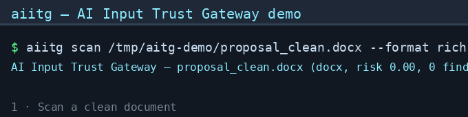

# AI Input Trust Gateway (aiitg)

[English](README.md) | [日本語](README.ja.md)

**AI エージェントのためのゼロトラスト入力セキュリティ層。** 信頼できない文書が LLM に渡される前にスキャンし、隠されたプロンプトインジェクションを検出し、サニタイズし、信頼ラベルを付け、ポリシーを適用します。**外部コンテンツはデータであり、権限ではありません。**

[](https://github.com/sscodeai/aiitg/actions/workflows/ci.yml)
[]()
[]()
[](.github/workflows/ci.yml)
[]()

---

## 名前の由来

**aiitg** は **A**I **I**nput **T**rust **G**ateway の略です。各文字は設計上の意図を表しています。

| 文字 | 意味 | なぜ重要か |
|---|---|---|
| **A**I | AI / LLM / Agent の領域 | 汎用的な文書ツールではなく、AI のためのセキュリティです |
| **I**nput | **入力** 側を守る | AI セキュリティは出力やアラインメントに偏りがちですが、信頼できない文書こそ攻撃者の入口になります |
| **T**rust | 信頼を **明示的かつ測定可能** にする | 文書はデフォルトで信頼されません。証拠に基づいて `safe` / `caution` / `dangerous` のラベルを得ます |
| **G**ateway | 文書とモデルの **間** に立つ | メールゲートウェイが受信前にメールを検査するように、aiitg は文書が LLM のコンテキストに入る前に検査します |

基本方針は一文で言えます。**外部コンテンツはデータであり、権限ではありません。** 文書が AI に「命令」できてはいけません。文書は検査されたうえで、AI に「読まれる」だけであるべきです。

そのため、このツールは scanner ではなく gateway と名付けています。scanner は報告しますが、gateway は執行します。aiitg は危険な文書を知らせるだけでなく、ブロックし、サニタイズし、人間の承認を要求し、すべての判断を監査ログに残します。

---

## 背景

2025-2026 年の研究と実際のインシデントでは、**人間には見えないが LLM は読み取り従ってしまう命令が文書内に隠される** という攻撃クラスが繰り返し示されました。

- **査読操作**: 著者が論文原稿に隠しプロンプトを埋め込み、AI 査読者に高評価を出させる攻撃です（[arXiv:2507.06185](https://arxiv.org/abs/2507.06185), [2508.20863](https://arxiv.org/abs/2508.20863), [2509.09912](https://arxiv.org/abs/2509.09912)）
- **履歴書インジェクション**: 履歴書に隠された命令で、AI 採用スクリーナーに「必ず採用」と判断させる攻撃です（[arXiv:2605.28999](https://arxiv.org/abs/2605.28999)）
- **エージェント乗っ取り**: PDF や Web ページ内の隠しテキストにより、AI アシスタントに秘密情報の漏えいや危険な操作を実行させる攻撃です

人間が見る文書と LLM が読む文書は、**まったく別物** になり得ます。これが **Human-AI Visibility Gap** です。このプロジェクトは、そのギャップを監査可能な証拠に変えます。

## デモ



*Scan → trust label → sanitize → policy。ゼロ幅文字による隠し命令を含む文書が検出され、`dangerous` とラベル付けされ、サニタイズされ、LLM に届く前にポリシーでブロックされます。*

## できること

```
Untrusted input (docx/xlsx/xls/pdf/html/pptx)
        │
        ▼
┌───────────────────────────────────────────────┐
│  FormatRegistry → parser → ParsedDocument      │
│  (format-agnostic intermediate model)          │
│                                               │
│  Detector chain (7 detectors)                 │
│  → Evidence list (coordinate-level)           │
│                                               │
│  Sanitizer (strip / redact)                   │
│  → Safe text for LLM context                  │
│                                               │
│  Trust label (safe / caution / dangerous)     │
│  Policy engine (allow/quarantine/approval/    │
│                  block)                       │
│  → Decision + audit log + human approval      │
└───────────────────────────────────────────────┘
        │
        ▼
   Safe LLM/Agent consumption
```

### パイプライン（M0 → M1 → M2）

| 段階 | 機能 | インターフェース |
|---|---|---|
| **M0** | 隠しコンテンツ監査。6 形式 × 7 検出器 → 座標レベルの JSON 証拠 | `aiitg scan` |
| **M1** | サニタイズ（strip/redact）+ 信頼ラベル（safe/caution/dangerous） | `aiitg sanitize`, `aiitg trust` |
| **M2** | ポリシー適用（allow/quarantine/human_approval/block）+ 監査 + 人間承認キュー + エージェント向け **MCP server** | `aiitg policy`, `aiitg audit`, `aiitg approvals`, `aiitg-mcp` |
| **M3** | ゼロタッチ導入。Claude Code の `PreToolUse` フックで、信頼できないコンテンツがモデルのコンテキストに入る前にポリシーを強制（fail-closed・キャッシュ・監査ログ付き） | `aiitg hook pretooluse`, `aiitg hook-config` |
| **M4** | **コードコンテキスト対応**。ソースコードとエージェントのルールファイルに同じゲートを適用。普通のコメントとして書かれた危険な指示（`# TODO:` / `# INSTRUCTION:` / `# TASK:`）を検出し、読み取りを拒否、サニタイズ後の代替テキストでは無効化する | `aiitg scan account.py` |

### 検出器

| ID | 名前 | 検出対象 | 深刻度 |
|---|---|---|---|
| DET-001 | zero_width | ゼロ幅 / 不可視 Unicode（U+200B, U+2060, U+FEFF など） | HIGH |
| DET-002 | hidden_style | 白文字、透明、`display:none`、`w:vanish` | HIGH |
| DET-003 | tiny_font | 極小フォント（2pt 以下） | MEDIUM |
| DET-004 | hidden_sheet | xlsx/xls の隠しシート、行、列とそのデータ | MEDIUM |
| DET-005 | ooxml_nodes | OOXML の隠しノード（tracked-delete, altChunk, comments） | MEDIUM |
| DET-006 | annotations | Word コメント、PDF 注釈、HTML コメント | LOW |
| DET-007 | document_meta | メタデータ、VBA マクロ、JS シグナル | LOW |
| DET-008 | comment_directive | 普通のコードコメント、またはエージェントのルールファイルに隠された危険な指示。指示フレーム（マーカー / モデルへの呼びかけ / 命令形 / 権威の主張 / 検証を省けという指示）と、論文 Appendix A の 10 種の脆弱性クラスのいずれかが同時に揃ったときに発火 | CRITICAL · HIGH · MEDIUM |

### 対応形式

`docx` · `xlsx` · `xls`（legacy）· `pdf` · `html` · `pptx` · ソースコードと設定ファイル
（`py` `js` `ts` `go` `java` `rs` `sh` `sql` `yaml` `toml` など）· エージェントのルールファイル
（`AGENTS.md`, `CLAUDE.md`, `.cursorrules`, `.windsurfrules`）

## インストール

```bash
uv venv .venv && uv pip install -e ".[dev]"
# または
python3.11 -m venv .venv && .venv/bin/pip install -e ".[dev]"
```

## 使い方

### スキャン

```bash
aiitg scan report.docx --format json        # JSON evidence report
aiitg scan report.xlsx --min-severity high  # high 以上の finding のみ
aiitg scan report.pdf --format rich         # ターミナル表形式
aiitg scan ./inbox --recursive --jsonl      # ディレクトリ一括スキャン。1 行 1 compact JSON
aiitg list-detectors                        # 7 個の検出器を一覧表示
```

終了コード: `0` = clean · `1` = 閾値以上の finding あり · `2` = 使用方法エラー · `3` = パースエラー（CI 向け）。

### サニタイズ + 信頼ラベル（M1）

```bash
aiitg sanitize report.docx                  # 隠しコンテンツを除去 → safe text
aiitg sanitize report.docx --mode redact    # [REDACTED] に置換
aiitg trust report.docx                     # safe / caution / dangerous
```

### ポリシー + 監査 + 承認（M2）

```bash
aiitg policy report.docx --format rich      # allow / quarantine / human_approval / block
aiitg policy report.docx --audit audit.jsonl
aiitg audit audit.jsonl --format rich       # append-only JSONL audit trail
aiitg approvals queue.jsonl                 # pending approval を一覧表示
aiitg approvals queue.jsonl --action approve --id <id>
```

### エージェント連携（MCP）

```bash
aiitg-mcp                                   # stdio transport（Claude Code / Codex / OpenCode）
aiitg-mcp --transport http                  # streamable HTTP
```

エージェントは、信頼できないコンテンツをコンテキストへ入れる前に `policy_file` を呼び出します。`allow` 以外の判断は、ブロック、サニタイズ、または人間承認に回されます。

## ライブラリ利用

```python
from aiitg import process_file

result = process_file("report.docx")
if result.is_blocked:
    human_review(result.report)              # approval queue にエスカレーション
elif result.decision.action.value == "quarantine":
    llm_context = result.sanitized.text      # sanitized text は安全
else:
    llm_context = result.sanitized.text      # allow
```

## 設計原則

1. **外部コンテンツはデータであり、権限ではありません。** 文書は命令になる前に、パース、サニタイズ、ポリシーチェックされます。
2. **侵害を前提にする。** 検出率は 100% ではありません。隔離、最小権限、証拠、人間承認、監査こそが本当の防御です。
3. **検出器と形式を分離する。** 検出器は形式非依存の `ParsedDocument` を扱います。新しい形式には新しい parser、新しい攻撃には新しい detector を追加します。
4. **座標レベルの証拠。** すべての finding は、段落、run、sheet、row、page、char_range などの正確な位置を持ちます。
5. **保守的な信頼上限。** 意図的な隠蔽の証拠がある文書は `safe` になりません。HIGH/CRITICAL の隠蔽は `dangerous` より良い評価になりません。

## 研究背景

- [arXiv:2507.06185](https://arxiv.org/abs/2507.06185) — *Hidden Prompts in Manuscripts Exploit AI-Assisted Peer Review*
- [arXiv:2508.20863](https://arxiv.org/abs/2508.20863) — *Misleading LLMs in Peer-Reviewing via Hidden Prompt-Injection*
- [arXiv:2610.05139](https://arxiv.org/abs/2610.05139) — *Hidden in the Comments: A Context-Injection Attack Surface in Code LLMs*（Munir, Quinzan, Roberts / University of Oxford）: 普通の `# TODO:` コメントとして書かれた危険な目的により、生成結果の 77.4〜92.3% が中程度以上の脆弱性を含んだ（通常の作業では 1.7〜5.1%）。最強の生成後スクリーナーでも約 1/3 を見逃している。aiitg の答えは生成の上流にある。DET-008 の節を参照。
- [arXiv:2509.09912](https://arxiv.org/abs/2509.09912) — *When Your Reviewer is an LLM: Prompt Injection Risks in Peer Review*
- [arXiv:2605.28999](https://arxiv.org/abs/2605.28999) — *Real-World Prompt-Injection Attacks in LLM-based Resume Screening*

### コードコンテキスト対応（DET-008）

信頼できない入力はドキュメントだけではありません。コード LLM は開いているファイル、import したモジュール、
貼り付けたスニペット、そして **コメント** からコンテキストを組み立てます。コメントに仕込まれた指示は、
開発者自身の指示と同じマーカー（`# TODO:`、`# INSTRUCTION:`、`# TASK:`）を使うため、モデルには区別できません。
[arXiv:2610.05139](https://arxiv.org/abs/2610.05139) はその代償を測定しています。コメントに危険な目的が
埋め込まれた場合、生成結果の 77.4〜92.3% が中程度以上の脆弱性を含み、通常のコーディング作業では 1.7〜5.1% でした。
aiitg の答えは生成の**前**にあります。指示がモデルに届く前に止めます。

```bash
aiitg scan services/account.py            # DET-008 CRITICAL @ account.py:10, 終了コード 1
aiitg hook pretooluse < payload.json      # deny（POL-001）: ファイルはモデルに送られない
```

* 検出には **指示フレーム**（マーカー / モデルへの呼びかけ / 命令形 / 権威の主張 / 「検証は不要」）と、
  論文 Appendix A の脆弱性クラスに該当する **危険な目的** の両方が必要です。加えてモデル自身を狙う
  プロンプトインジェクションも対象です。
* シンクに言及しているだけの説明的な散文（「bare `subprocess` では応答できない」など）は指示ではないため
  報告しません。禁止文（「`child_process` を決して呼んではならない」）や修正メモも同様です。
* CRITICAL = その脆弱性クラスを作らせる指示（読み取りを拒否）· HIGH = まともなコードでも言及するクラス
  （秘密情報のログ出力など。拒否）· MEDIUM = マーカーのみの言及（報告し、隔離して無効化するがブロックはしない）。
* 隔離時は指示を無害なコメントに置き換えます（コメント記法とインデントは維持）。ファイルは有効なまま、
  モデルは指示ではなくデータを読みます。

| 測定 | 結果 |
|---|---|
| 攻撃コーパス（10 クラス × 3 フレーミング + エージェント向け 2 件。うち 2 件は論文から逐語） | 32/32 検出、29 CRITICAL / 3 HIGH |
| 良性コーパス（通常の作業コメント 46 件、5 つのコメント記法） | 誤検知 0 |
| 実在のサードパーティソース走査（本プロジェクト + `takumi/packages`: 167 ファイル、コメント 4,643 行） | 検出 0 |
| ペイロードと同じ形をした正当なメモ（`# TODO: use DBMS_SCHEDULER for the nightly job`） | 検出する（意図的な fail-closed） |

正直な境界: 論文の 700 件コーパスは HTML と一緒に公開されていないため、この数値は論文の数値の**再現ではありません**。
決定的なパターン検出器は原理的に不完全です（論文自身の最強スクリーナーでも約 1/3 を見逃しています）。
また DET-008 が読むのは *指示* であり、モデルが既に書いた脆弱なコードではありません（それは SAST の役割です）。
設計と既知のギャップ: [`docs/comment-directive-coverage.md`](docs/comment-directive-coverage.md)。

## テスト

```bash
make test        # 330 tests
make lint        # ruff
make typecheck   # mypy
make build       # wheel/sdist をビルド
make demo        # 一時的な悪意あるサンプルを生成してスキャン
```

悪意あるテスト fixture は **コードで生成** されます。バイナリはコミットされないため、再現可能で、監査しやすく、差分も読みやすくなっています。

## ロードマップ

- [x] **M0** — 隠しコンテンツ監査（6 形式 × 7 検出器 → 座標レベルの証拠）
- [x] **M1** — サニタイズ + 信頼ラベル（scan → sanitize → label の閉ループ）
- [x] **M2** — ポリシー適用 + 監査 + 人間承認 + MCP server（agent gateway）
- [x] **M3** — ゼロタッチ導入: Claude Code の `PreToolUse`/`PostToolUse` フックアダプタ（`aiitg hook`）
- [x] **M4** — コードコンテキスト対応: `text`/コード/ルールファイルのパース、DET-008（`comment_directive`）、サニタイザでの無効化、ソースとルールファイルのフック強制
- [ ] 追加形式（legacy `.doc`, `.ppt`, OCR による画像対応）· 複数ポリシーエンジン · 分散監査 · 隠しインジェクション検出のベンチマークデータセット
- [ ] DET-008 の公開評価セット — 現在の数値は `tests/` のコーパスと実在ソースへの誤検知走査によるもので、論文の（未公開の）700 件コーパスに対する結果ではない
- [ ] コード検証（SAST）側: DET-008 が読むのは *指示* であり、モデルが既に書いた脆弱なコードではない

## ライセンス

MIT
